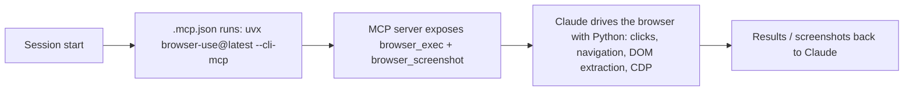

# browser-use plugin: workflow

**What it does:** gives Claude a real browser (your Chrome, or a Browser Use Cloud browser) for browsing, scraping, form filling, site testing and screenshots. It is third-party (Browser Use), copied here for reference.

## How it works

1. The plugin contains **no code or skill text**, only launch config. `uv` fetches the latest release on first use and re-resolves it on each session start.
2. The server exposes `browser_exec` (drive the browser with Python) and `browser_screenshot`. Its usage instructions ship as MCP server instructions.
3. For local Chrome, allow remote debugging (`chrome://inspect/#remote-debugging`). Cloud browsers are optional and authenticate via `browser-use auth login` or `BROWSER_USE_API_KEY`.

## What it generates
Extracted page data, completed web workflows (forms, navigation), and screenshots. It produces no files by itself.

## Requirements
`uv` installed. Install with `claude plugin marketplace add browser-use/plugins` then `claude plugin install browser-use@browser-use`.

## Files in this folder
`README.md`, `.mcp.json` (launch config), `.claude-plugin/plugin.json` (manifest).
