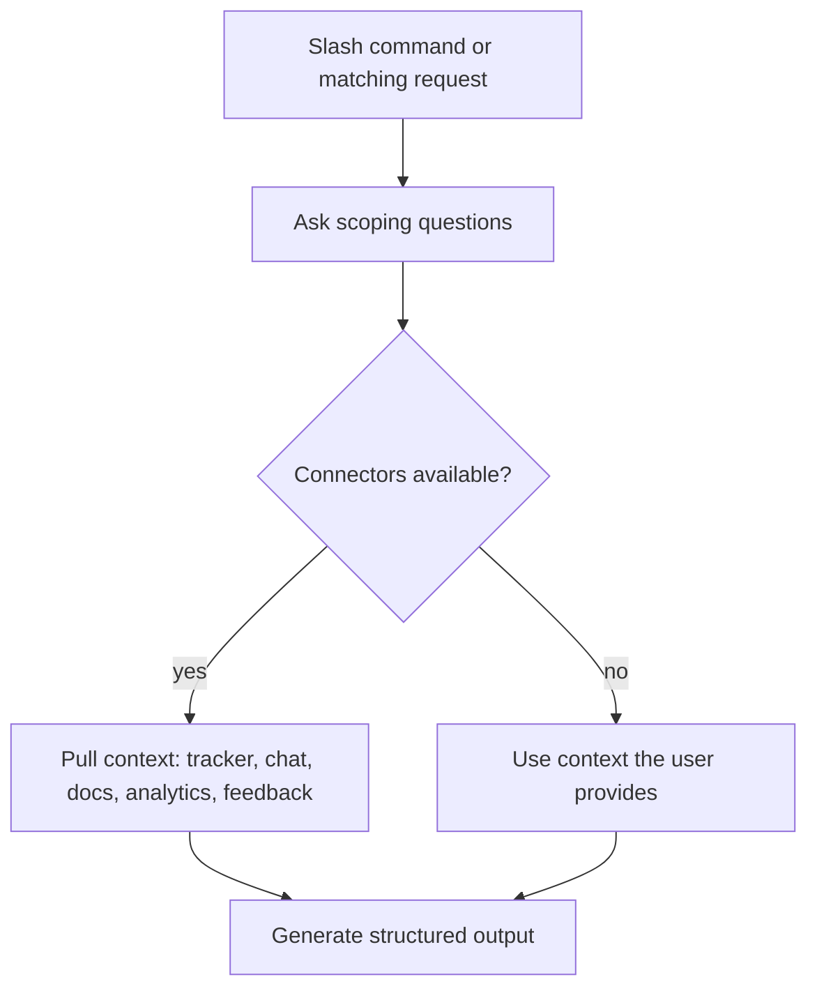

# product-management plugin: workflow

**What it does:** a PM partner covering specs, roadmaps, stakeholder updates, research synthesis, competitive briefs, metrics review, sprint planning and brainstorming. It is the Anthropic knowledge-work plugin, copied here for reference.

## How it works

Standalone mode always works. Connectors (`~~category` placeholders in the files: Slack, Linear/Asana/Jira, Notion, Figma, Amplitude/Pendo, Intercom, Fireflies and others) only add context.

## Skills and what each generates

| Skill / command | Generates |
|---|---|
| `write-spec` | PRD: problem, goals/non-goals, user stories, requirements, success metrics, open questions, phasing |
| `roadmap-update` | Now/Next/Later or quarterly roadmap, reprioritization and dependency moves |
| `stakeholder-update` | Weekly, monthly, launch or escalation update tailored to the audience |
| `synthesize-research` | Themes ranked by frequency and impact, personas, opportunity areas with evidence |
| `competitive-brief` | Feature comparison, positioning, strategic implications |
| `metrics-review` | Scorecard with trends, comparison to targets and recommended actions |
| `sprint-planning` | Scoped sprint, capacity estimate (PTO and meetings), goals, P0 vs stretch, carryover |
| `product-brainstorming` / `/brainstorm` | A conversational sparring session (How Might We, JTBD, first principles), not a deliverable |

## Files in this folder
`README.md`, `CONNECTORS.md`, `commands/brainstorm.md`, `skills/*/SKILL.md` (8 skills), `.mcp.json`, `.claude-plugin/plugin.json`, `LICENSE`.
