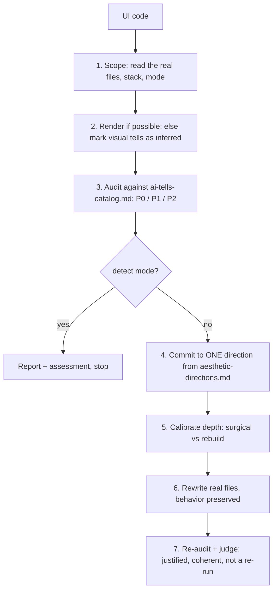

# avoid-ai-design: workflow

**What it does:** audits frontend UI for generic "AI slop" patterns, then rewrites it around one intentional design direction. It covers HTML/CSS and React/Tailwind/shadcn.

**Triggers:** "de-slop this UI", "make this look less AI-generated", "audit this component", "fix generic Claude/Codex frontend".

**Modes:** `rewrite` (default: audit, then edit) and `detect` (audit and score only, no edits; for "just audit", "flag only", "scan").

## How it works

**Severity tiers** (who notices):

- **P0:** a layperson sees it (purple-blue gradient, Inter everywhere, untouched shadcn theme, gradient headline text, reflexive glassmorphism).
- **P1:** a designer or developer sees it (`rounded-2xl shadow-lg` everywhere, default page shell, icon-in-square, dead hover/focus states).
- **P2:** craft gaps (flat spacing rhythm, no motion).

## What it generates
1. Audit with every tell, its location, severity, reason and a code-certain/inferred tag
2. The chosen design direction (type pairing, palette stance, layout, motion, signature detail) with 1-2 alternatives
3. Edited code at the right depth
4. A short "what changed" summary
5. A re-audit and judgment of the result

## Guardrails
- Never break props, state, routing, data flow or accessibility.
- Don't swap one cliché for another (the "Space Grotesk trap").
- Respect existing design systems.
- If the UI is already distinctive, say so and stop.

## Files in this folder
`SKILL.md`, `references/ai-tells-catalog.md` (the tells), `references/aesthetic-directions.md` (directions to commit to).
