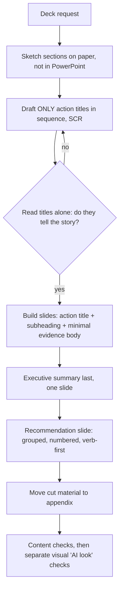

# consulting-presentation-storyline: workflow

**What it does:** structures and writes McKinsey/BCG/Bain-style decks. The storyline (the action titles read in sequence) is the real deliverable, and slides are the evidence under it. It pairs with the `pptx` skill when a PowerPoint file is needed.

**Triggers:** strategy deck, business case, "make this board-ready / McKinsey-level", "this looks AI-generated / templated", deck critiques, executive summaries, recommendation slides.

## How it works

**Deck structure:** frontpage → executive summary → body → recommendations/next steps → appendix. The strategy-house variant adds five layers: aspiration, strategic choices (including what is *not* being done), initiatives with KPIs, enablers, foundation.

**Slide anatomy:** a full-sentence action title, a one-line subheading, and a body where every element supports the title.

## What it generates
- A deck storyline (action-title sequence) with notes on the evidence each slide needs
- Slide-level copy, an executive summary and recommendation slides
- A critique against seven AI failure patterns and six visual "AI look" markers
- With `pptx`, the actual `.pptx` file

## Notes
- Use a 6-step AI workflow: keep the structuring and the editing human, and delegate drafting and polish.
- Vary layout by content type, not by template rotation.
- It ends with a quick self-check list for each slide and the whole deck.

## Files in this folder
`SKILL.md`, `references/ai-tooling-landscape.md` (template libraries, add-ins and AI slide tools compared).
