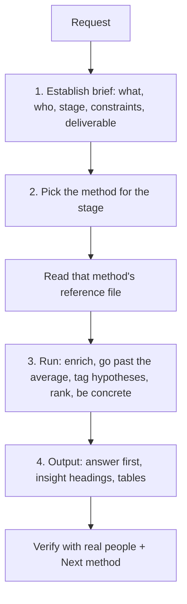

# design-thinking-agent: workflow

**What it does:** a design-research copilot that runs nine design-thinking methods (from Prof. Intriligator's toolkit at Tufts) on a product, service or client project, and returns answer-first results the team can verify with real people.

**Triggers:** "run a SUN", "CLIMBER this", "persona multiplication", "DOTMET", "funnel glide", "time glide", "failure ecology", "constraint collision", "turn the client ask into research questions", or any stakeholder, persona, interview-plan or down-select request. Also used for Product Design course milestones.

## How it works

**Method picker**

| Need | Method |
|---|---|
| Vague client ask | Client ask → research questions |
| Space too big | Funnel glide |
| Make forecasts specific | Time glide |
| Who is the customer | CLIMBER C+L (under 500 words) |
| Full stakeholder/user map + interview plan | SUN analysis |
| Deep task understanding | MTA / TTA |
| Personas beyond the design team | Persona Multiplication, then DOTMET |
| How it fails in real life | Failure ecology (25 failures) |
| Kill weak concepts | Constraint collision (survives / wounded / dead) |

**Default sequence from zero** (one method per turn): client ask → funnel glide → time glide → CLIMBER C+L → SUN → Persona Multiplication + DOTMET → failure ecology → constraint collision → CLIMBER I→R.

## What it generates
- Ranked tables (stakeholders, personas, failures, concept scores)
- Interview plans and "how might we" statements
- A closing **Verify with real people** block (3-5 tests, with whom, cheapest method)
- A **Next method** recommendation
- On request, a chart, slide or document in the format asked

## Rules
- Separate known facts from hypotheses.
- Stop where the method says to stop (for example, funnel glide waits after listing areas).
- Respect the word limits.

## Files in this folder
`SKILL.md` plus `references/`: `client-ask`, `funnel-glide`, `time-glide`, `climber`, `sun-analysis`, `mta-tta`, `persona-multiplication`, `dotmet`, `failure-ecology`, `constraint-collision` (each a runnable procedure), and `source-prompts` (the original prompts, verbatim).
