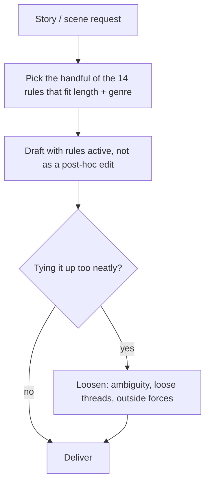

# human-writer: workflow

**What it does:** applies the *structural* fingerprints that separate AI fiction from human fiction (StoryScope, COLM 2026) as active writing constraints while drafting. It targets plot, causality, time, and emotion rendering, not just word choice.

**Triggers:** any fiction, short story, narrative scene or creative prose request. It applies proactively, even if the user never mentions style.

## How it works

The 14 rules push against these AI habits:

- Over-explained themes and "meaningful" dialogue
- Clean single-track causality and protagonist-driven, internally resolved endings
- Over-somaticized emotion and smell-as-mood
- Setting used only as a psychological mirror
- Strictly linear time and a closed fourth wall
- Vague references and flattened moral ambiguity
- A narrow social world, flat intensity and voice, and a tidy epilogue

## What it generates
Fiction or narrative prose built with these structural choices: looser causality, nonlinear time where it fits, specific named references, ambiguous endings.

## Notes
- Not every rule applies to every piece. A 300-word flash story doesn't need nonlinear time.
- This is not about typos or slang, which are surface-level and not what the research found.

## Files in this folder
`SKILL.md` only.
