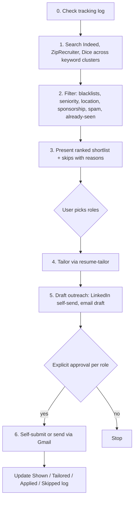

# job-search-automator: workflow

**What it does:** runs a recurring co-op / new-grad job search: source postings, filter to real fits, tailor resumes, draft outreach, and get explicit approval before anything is sent or applied to.

**Triggers:** "run my job search", "find me jobs", "today's job list", or any reference to the recurring job hunt.

## How it works

1. **Check the log first**, so no posting is shown twice.
2. **Search** several keyword clusters per platform. Aims for about 30 genuine fits a day and says so if there are fewer.
3. **Filter without asking:** company and title blacklists, seniority mismatches, out-of-scope location or function, sponsorship conflicts, staffing spam, pay-to-train outfits, already-seen roles.
4. **Present the shortlist** (strong fits, plus borderline skips with reasons) and **stop** until the user picks.
5. **Tailor** the chosen roles through the full `resume-tailor` workflow.
6. **Outreach is drafted, never sent unprompted.** LinkedIn is always self-send. Email is sent via Gmail only after approval of that specific message.
7. **Applying needs approval for each role.** Last time's answer does not carry over.

## What it generates
- A ranked daily shortlist (title, company, location, comp, apply link, one-line fit reason)
- Tailored resumes for selected roles
- Outreach and application email drafts
- A running Shown / Tailored / Applied / Skipped log

## Notes
- It runs when invoked. For a true unattended daily run, set it up as a scheduled task.
- Demographic self-ID fields are never stored for autofill.

## Files in this folder
| File | Role |
|---|---|
| `SKILL.md` | Instructions, standing search profile, filters and approval gates |
