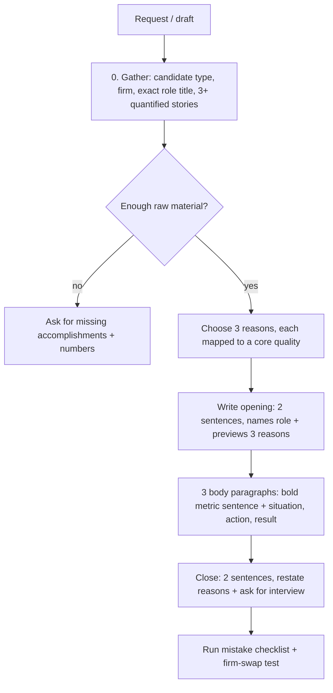

# mckinsey-cover-letter: workflow

**What it does:** drafts, reviews or scores a McKinsey (or BCG/Bain) cover letter against an enforceable rule set, based on the Hacking the Case Interview guide.

**Triggers:** writing, editing, tightening or critiquing a consulting cover letter. Also "why consulting" paragraphs, or questions about MBB cover letter length, format or what firms look for.

## How it works

**Format specs**

- 250-400 words, one page (BCG 300-400, Bain 250-350)
- Exactly 5 sections: contact, salutation, opening, 3 body paragraphs, close
- Times New Roman, Calibri or Cambria, 10-12pt, 1-inch margins, left-aligned

**McKinsey's four qualities** (hit 2-3, each backed by a numbered example): Personal Impact, Entrepreneurial Drive, Leadership, Problem Solving.

## What it generates
- A formatted cover letter draft, or a scored critique with concrete fixes
- Flags for missing numbers, generic claims, or title mismatches

## Rules that matter
- Every claim needs a receipt: no adjective without a quantified example.
- Firm-swap test: if another firm's name fits unchanged, the letter is too generic.
- Never invent numbers. Ask for them.
- Networking mentions are capped at one substantive sentence.
- Tailors by candidate type (undergrad, MBA, career changer) and handles red flags in 1-2 sentences.

## Files in this folder
`SKILL.md` only.
