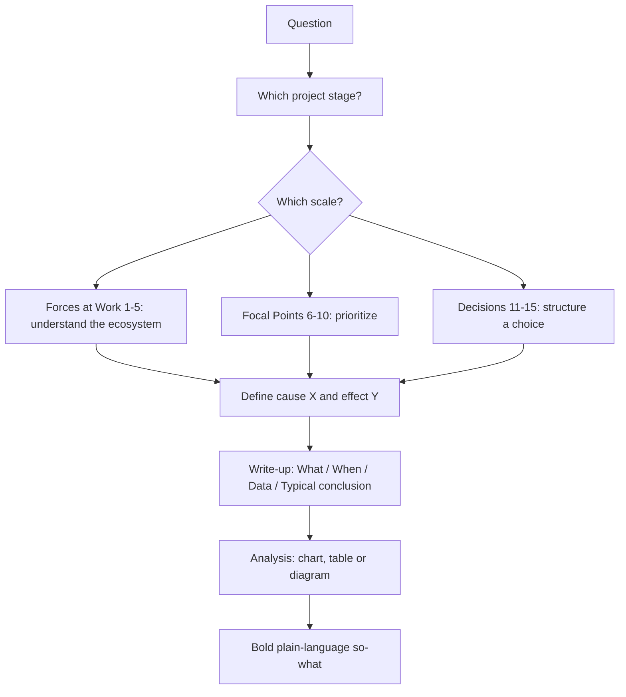

# partha-analytics-strategy: workflow

**What it does:** applies one or more of 15 management-consulting analytical tools (Ghosh & Pugh, *Art & Science of Problem Solving*) to a strategy, market, competitive or problem-scoping question.

**Triggers:** strategy or industry analysis, "which framework fits", or any single named tool ("do a Pareto analysis", "map the five forces", "build a gap analysis slide").

## How it works

**The 15 tools**

| Scale | Tools |
|---|---|
| Forces at Work | Forces/Five Forces, Value chain, Trend, Gap, System dynamics |
| Focal Points | Pareto, Leading/lagging indicators, Trade-offs/equilibrium, Portfolio mapping, Root cause (fishbone) |
| Decisions | Cause-and-effect/regression, Elasticity/sensitivity, Cluster/segmentation, Marginal utility/decision trees, Monte Carlo |

Combine several tools rather than picking one. It is fine to invent a new analytic if none fit, after checking this list.

## What it generates
- A tool write-up in the What / When / Data / Typical-conclusion template
- The analysis itself (chart, table or diagram)
- An insight-bearing, answer-first takeaway sentence
- Slide-ready content when paired with `consulting-presentation-storyline`

## Files in this folder
`SKILL.md` only, which includes a quick-reference table matching an insight need to a tool.
