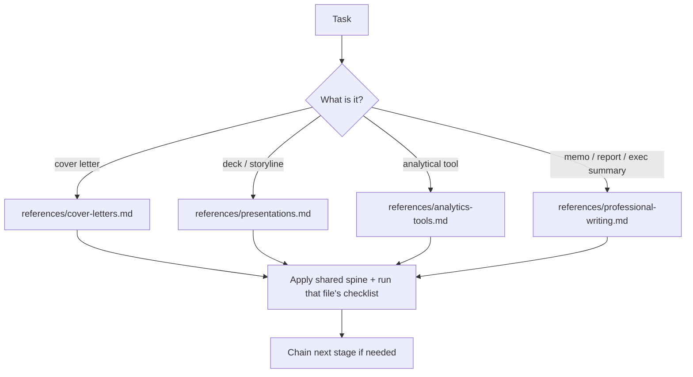

# partha-brain-strategy-presentation: workflow

**What it does:** a consolidated router for the consulting-craft toolkit: how to argue (analytics), write it up (professional writing, cover letters) and present it (deck storyline). It holds the shared discipline and sends each task to the matching reference file.

**Triggers:** a cover letter, a strategy deck, a named analytical tool, or a memo or executive summary. Also "make this McKinsey-level", "board-ready", "not AI-looking", or "tighten this writing".

## How it works

**Shared spine (applied in every domain):**

1. Answer first, evidence second (BLUF).
2. Every claim needs a receipt.
3. Insight-bearing titles and headings.
4. Structure before content.
5. Subtractive editing, with cut material moved to an appendix.

**Typical chain:** run an analytics tool → write the finding as a memo → turn it into slides. Each reference file is loaded only when that stage is reached.

## What it generates
Whatever the routed reference produces: a cover letter, deck content, an analytic write-up (What / When / Data / Conclusion plus a so-what), or a memo or report. Each is checked against that file's checklist.

## Files in this folder
| File | Covers |
|---|---|
| `SKILL.md` | Router and shared spine |
| `references/cover-letters.md` | MBB cover letters |
| `references/presentations.md` | Deck storyline, SCR, strategy house |
| `references/presentation-assets/ai-tooling-landscape.md` | Tool and template comparisons (load only if asked) |
| `references/analytics-tools.md` | The 15 analytical tools |
| `references/professional-writing.md` | Memos, reports, executive summaries |

The same content also exists as standalone skills: `mckinsey-cover-letter`, `consulting-presentation-storyline`, `partha-analytics-strategy` and `professional-writing`.
