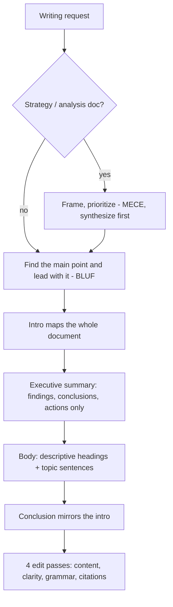

# professional-writing: workflow

**What it does:** rules for professional and academic documents (memos, emails, reports, executive summaries, papers) that busy readers can skim. It is used both to draft and to review. Based on the Stanford Technical Communication Program, UF/IFAS Extension and McKinsey-alumni guidance.

**Triggers:** writing, drafting, revising or reviewing any memo, email, report, executive summary or paper, or asking to make writing "professional", "concise", "executive-ready" or "academic".

## How it works

**Review mode:** it quotes each offending sentence and proposes a fix. It checks for:

- A buried main point
- Generic headings and missing topic sentences
- Unclear "this"/"it"
- Uncaptioned figures
- Wordiness, passive voice and hedges
- First person, contractions and exclamation points
- Repetitive sentence patterns
- Non-scholarly sources and citation mismatches

## What it generates
- A drafted memo, email, report or paper in a formal third-person register
- Or a concrete, quoted-and-fixed review of the user's own draft

## Notes
- The default is a formal register (no contractions, no first or second person) unless the user specifies a house style.
- The executive summary is not an introduction and not a table of contents. It must stand alone.

## Files in this folder
`SKILL.md` only.
