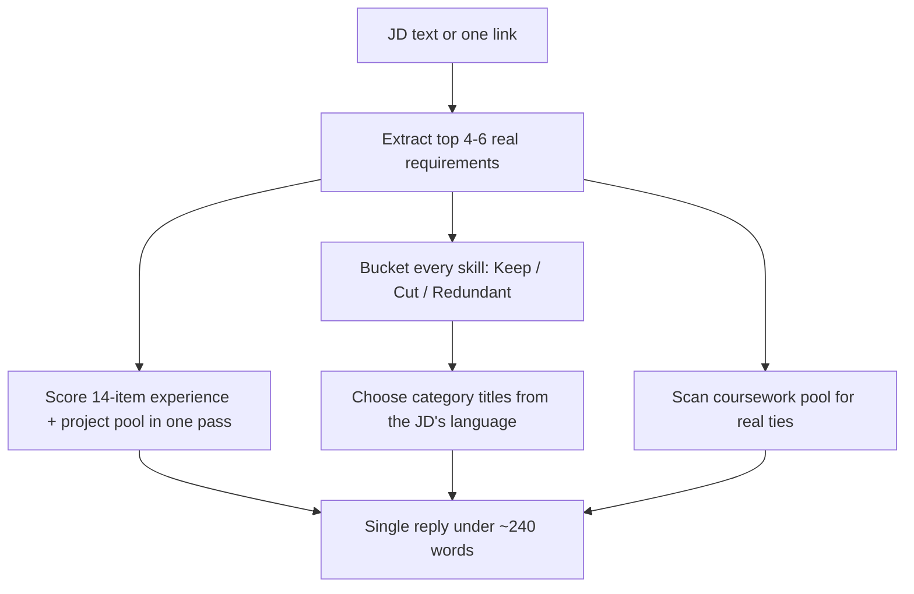

# resume-making-assistant: workflow

**What it does:** a fast, low-token decision tool. For one job posting it ranks which experiences, projects, coursework and skills to keep, cut, or hold as backup. It never drafts a resume. That is `resume-tailor`'s job, and this skill sits upstream of it.

**Triggers:** only on an explicit call ("/resume-making-assistant", "rank my experience for this") together with a JD or link. A bare pasted JD belongs to `resume-tailor`.

## How it works

1. Uses pasted JD text as is, or makes one fetch if only a link was given.
2. Pulls the JD's top 4-6 requirements and keywords, skipping boilerplate.
3. Scores experience and projects as **one interleaved pool** (direct matches highest, then transferable, then unrelated). Splits into two lists only if asked.
4. Puts **every** skill in exactly one bucket: Keep, Cut, or Redundant (a near-duplicate; keeps the stronger phrasing).
5. Renames or re-splits skill categories to fit the JD's domain.
6. Surfaces 0-4 courses only if they tie to the JD, with no grades.

## What it generates
One plain-text chat reply, nothing else:
- One-line role/culture read
- **Keep (ranked)**, **Cut**, and **Backup if page needs filling**
- **Relevant coursework** (omitted if nothing genuinely ties)
- **Skills: keep / cut / redundant**, with category titles

## Hard rules
- No files, no docx/pdf/artifact tools, no bullet drafting.
- Never invent an item that isn't in the pools, and never state a grade.
- Flags a stale pool in one line instead of guessing.

## Files in this folder
| File | Role |
|---|---|
| `SKILL.md` | Instructions plus the condensed experience, coursework and skills pools |
