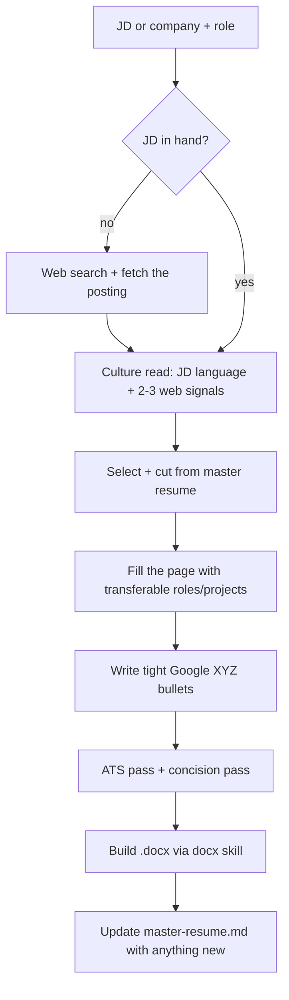

# resume-tailor: workflow

**What it does:** builds a one-page, ATS-optimized resume tailored to a specific job posting, using only verified history from `references/master-resume.md`.

**Triggers:** pasting or describing a JD, naming a company/role, "tailor my resume for X", adding a new job/project/course, or asking about ATS or culture fit.

## How it works

1. **Get the JD.** Asks for it if missing; searches the live posting if only company + role are given.
2. **Read the culture.** `references/culture-analysis.md` places the company on a waterfall ↔ matrix spectrum and states a one-line read before drafting.
3. **Select and cut.** Picks the roles, projects and bullets that answer the JD's top requirements. Reframes passive bullets into active, problem-finding ones without changing facts.
4. **Fill the page.** If white space remains, adds other real roles or projects with transferable skills. It never pads with filler or invented content.
5. **Write bullets.** Google XYZ format, one line (about 12-20 words), result first, every metric and named tool kept.
6. **ATS pass.** Checks against `references/ats-checklist.md`, then re-checks bullet concision as its own pass.
7. **Build the file.** Uses the `docx` skill. Section order is Education → Experience → Projects → Leadership/Awards → Skills, and Skills is always last.
8. **Keep the master current.** Writes any new job, project, course or corrected metric back into `master-resume.md`.

## What it generates
- A one-page tailored resume (`.docx`), saved to outputs and sent to the user.
- A one-line culture/role read shown with the draft.
- A short flag list of compromises (for example, "kept this at 10.5pt to fit; cut a bullet instead?").

## Hard rules
- Never fabricate a metric, tool, employer or link.
- Never claim an in-progress credential as held; use the honest in-progress phrasing from `coursework.md`.
- Never exceed one page, and never leave it visibly under-filled when real content is available.
- Projects use the same header-row layout as work experience.

## Files in this folder
| File | Role |
|---|---|
| `SKILL.md` | The skill instructions |
| `references/master-resume.md` | Source of truth for all resume content (contact details redacted in this public copy) |
| `references/coursework.md` | Optional coursework line and in-progress phrasing rules |
| `references/culture-analysis.md` | How to read company culture from the JD and web |
| `references/ats-checklist.md` | Parseability and keyword checklist |
| `assets/style_reference_sample.docx` | Layout/density reference only; its content belongs to someone else and is never copied |
