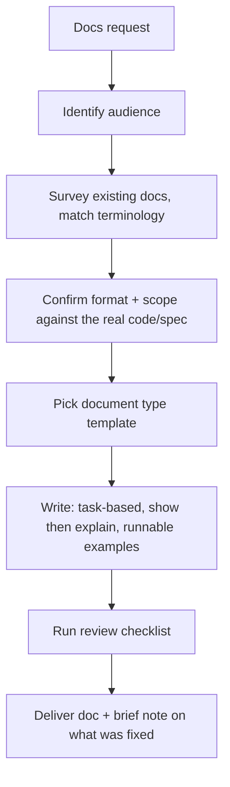

# technical-writer: workflow

**What it does:** writes, improves or restructures technical documentation (API references, SDK docs, guides, troubleshooting, changelogs, READMEs) so users succeed with minimal friction.

**Triggers:** drafting, editing or reviewing a README, API reference, user guide, tutorial or changelog. Also docs audits, content-gap analysis and docs-site information architecture.

## How it works

**Document types it knows:** API reference (including error responses), getting-started, user guide (task-oriented), troubleshooting (symptom → cause → fix), SDK/integration guide, changelog (grouped by user impact).

**Default structure:** title and one-line purpose → Prerequisites (if any) → Quickstart → task sections → Reference → Troubleshooting. Empty sections are dropped.

## What it generates
- Markdown docs, READMEs and docstrings
- Audits or edits with a short explanation of what was unclear before the rewrite
- Information-architecture plans for docs sites

## Review checklist
- Examples are runnable.
- Jargon is explained.
- Headings are searchable.
- Terminology is consistent.
- Error cases are covered.
- A reader with only the stated prerequisites could follow it.
- Nothing is stated as fact without verification against the code or spec.

## Files in this folder
`SKILL.md` only.
